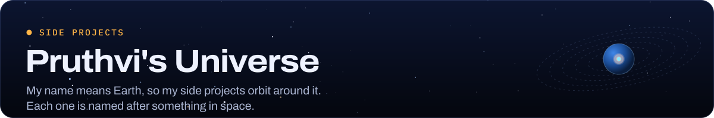
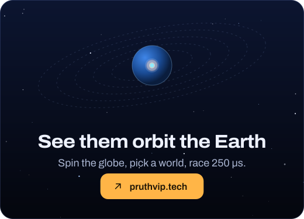
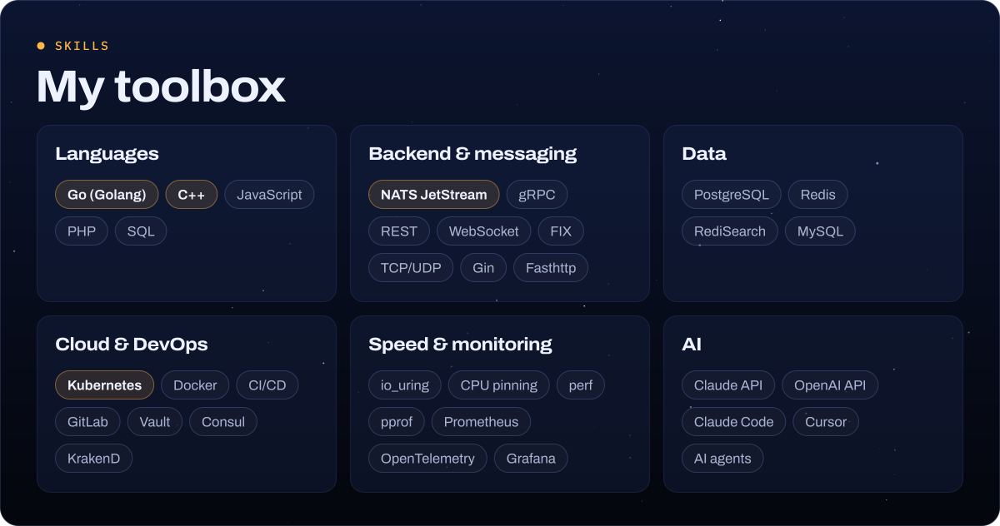

<!-- Pruthvi Panchal's GitHub profile. The images in assets/ are built by tools/build.mjs (see tools/BUILD.md); edit the words there, not in the SVGs. -->

  
  
  
  

Made on Earth, which is what <i>Pruthvi</i> means · <a href="https://pruthvip.tech">pruthvip.tech</a>

